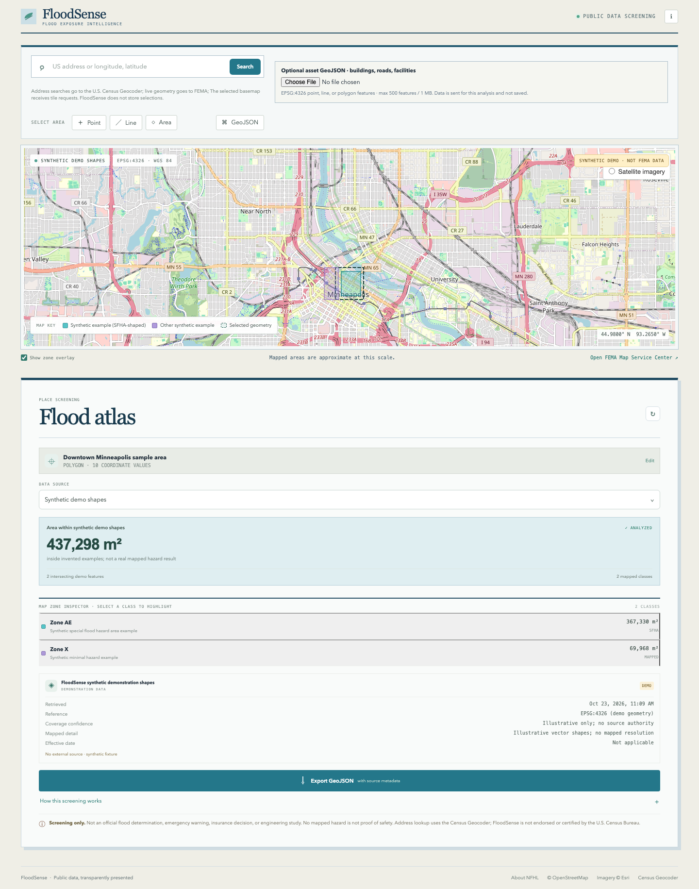
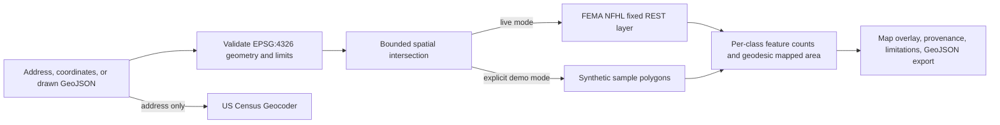

# FloodSense

**Live demo:** [floodsense-shxs.onrender.com](https://floodsense-shxs.onrender.com/)

FloodSense is a map-based screening tool for exploring mapped flood-zone overlap around places and infrastructure. It is an educational screening application, **not** an official flood determination, emergency warning, insurance decision, engineering study, or substitute for local authorities.

The starting sample is Downtown Minneapolis with an explicitly labeled synthetic example, so the first visit works without an external provider. Choose FEMA effective flood zones for live results. Search a US street address with the U.S. Census Geocoder, or enter `longitude, latitude` in EPSG:4326. Draw a point, line, or polygon on the map, or use the GeoJSON editor as a keyboard-operable alternative. Optionally load a bounded GeoJSON FeatureCollection (up to 500 point, line, or polygon assets / 1 MB) to screen user-supplied buildings, roads, or facilities against the returned polygons.

## Sample screen

The screenshot below is from the E2E demo flow. All overlay polygons in this view are synthetic illustrations, not FEMA data.



[Mobile workflow screenshot](docs/screenshots/mobile.png)

## Run locally

Requires Node.js 22 or newer.

```sh
npm ci
cp .env.example .env
npm run dev
```

Open the Vite URL shown in the terminal (normally `http://localhost:5173`). The production server serves both the built app and its API:

```sh
npm run build
npm start
```

No API key or account is required. If FEMA is unavailable, FloodSense shows the provider failure and offers an explicit action to switch to synthetic demo data; it never silently substitutes the fixture.

## How it works



The backend calls only fixed FEMA and Census endpoints. It does not fetch caller-provided URLs. The selected shape is checked for coordinate range, two-dimensional coordinates, valid rings/line topology, at most 500 vertices, a 5° by 5° maximum envelope, and (for polygons) a maximum 5,000 km² geodesic area. Selected geometry is capped at 64 KB; request JSON is capped at 1.2 MB to support optional assets, whose collection is separately capped at 1 MB and 500 validated features. FEMA requests time out after eight seconds, make at most one short retry, and return no more than 500 features or 5 MB of analysis output. The service is limited to four concurrent live FEMA requests and 30 API requests per minute per observed client IP. FEMA results are cached in memory for five minutes (up to 100 entries); uploaded assets are intersected after retrieval and never cached. FEMA source-retrieved timestamp is kept with the cached result. Geocoding results are not cached by FloodSense. Asset intersections are counts by FEMA zone; they are screening overlays, not parcel/building risk estimates.

Polygon areas are computed geodesically with Turf on FEMA geometries requested from its NAD83 (EPSG:4269) service in EPSG:4326. The FEMA service performs that output reprojection; this app is not a survey-grade datum transformation. Each mapped zone is intersected with the selected polygon. Total area and per-class areas are unioned before measurement to avoid double-counting duplicate or overlapping polygons. Per-class areas can overlap across classes. Point and line selections report intersecting feature counts and do not invent an area measurement. The NFHL query does not expose a uniform pixel resolution; mapping scale and effective date vary by panel.

## Data dictionary

| Result field             | Meaning                                                                                               |
| ------------------------ | ----------------------------------------------------------------------------------------------------- |
| `geometry`               | User-selected GeoJSON geometry; assumed EPSG:4326                                                     |
| `zones`                  | Source polygons intersecting the selection, with FEMA zone attributes                                 |
| `intersectingCount`      | Count of returned FEMA zone features intersecting the geometry                                        |
| `mappedAreaM2`           | Geodesic union area inside returned zones; polygon AOIs only                                          |
| `byClass[].zone`         | FEMA `FLD_ZONE` classification (for example AE or X)                                                  |
| `byClass[].subtype`      | FEMA `ZONE_SUBTY` description when present                                                            |
| `byClass[].sfha`         | FEMA `SFHA_TF` special-flood-hazard-area flag                                                         |
| `byClass[].featureCount` | Number of intersecting source features in that class                                                  |
| `byClass[].areaM2`       | Unioned polygon intersection area for that class; classes can overlap                                 |
| `source`                 | Source URL/name, retrieval time, CRS, coverage confidence, scale/resolution note, and panel-date note |

The main polygon total is the area inside NFHL zone polygons, including minimal-hazard Zone X. It is not a hazard probability or a statement that every mapped polygon has the same hazard. The category list preserves FEMA classes and SFHA flags.

## Data, terms, and attribution

See [the source and license ledger](docs/data-sources.md), [methodology and limits](docs/methodology.md), and [deployment guide](docs/deployment.md). FEMA NFHL and US Census Geocoder are the only analytical source providers; OpenStreetMap is the default display basemap, with Esri World Imagery available as an alternative. Basemap imagery is visual context, not flood data. Provider availability, map panels, geocoder benchmarks, terms, and usage policies can change. Review the linked primary documentation before changing endpoints or refreshing source behavior.

## Privacy and security

FloodSense requires no account and stores no address or geometry persistently. Address text is sent to the U.S. Census Geocoder for matching. In live mode, the selected geometry is sent through the FloodSense backend to FEMA for spatial querying. If assets are uploaded, their GeoJSON features are sent with that request and processed in memory; they are not cached or persisted. The selected basemap provider receives requests for visible tiles; imagery is display-only and is not used in the analysis. FloodSense does not log request bodies or exact locations. FEMA query results and rate-limit counters are held in process memory only; provider responses use `Cache-Control: no-store` to prevent browser/proxy storage. See the disclosure beside the address search.

The API uses fixed provider URLs, bounded response streaming, input/query/response limits, timeouts, one bounded retry, in-memory result caching, a four-query concurrency limit, per-IP request limits, restrictive CORS, safe error messages, and security headers. For TLS termination behind a reverse proxy, set `TRUST_PROXY_HOPS` to the exact trusted hop count; the default `0` ignores forwarded protocol and IP headers. Never set an untrusted `ALLOWED_ORIGIN` wildcard.

## Verification

```sh
npm run format:check
npm run lint
npm run typecheck
npm test
npm run build
npm run test:e2e
```

Tests cover invalid CRS coordinates, invalid/self-crossing geometry, feature and AOI limits, boundary contact, point and polygon intersection, area union/deduplication, bounded asset GeoJSON and FEMA-zone intersections, malformed provider features, provider failure, provider feature limits, and explicit source-mode validation. CI runs these checks on pushes and pull requests. The browser workflow covers sample AOI → source selection → source metadata → GeoJSON export. Upload a small point/polygon FeatureCollection to test the optional asset workflow. Basemap errors display an on-map fallback while analysis and geometry editing remain available.

Before exact Turf intersections, FloodSense rejects geometry pairs whose inclusive longitude/latitude bounding boxes are disjoint. This is a candidate filter only; every possible overlap still goes through the exact geometry predicate, so boundary-touch semantics remain. A deterministic sparse fixture confirms 500 exact candidates out of 250,000 possible asset-zone pairs while retaining all 500 expected touches/intersections.

## Limitations

FloodSense shows effective mapped flood zones, not a predictive model or a comprehensive flood model. FEMA mapping coverage and effective dates vary; unmapped areas can still flood. The layer does not establish parcel-scale accuracy, represent every local study, or guarantee assumptions about levees and structures. It does not model rainfall-driven/pluvial flooding, changing climate or land use, future events, or site-specific drainage. A mapped absence is not proof of safety. For official maps and panel dates, consult the FEMA Map Service Center; follow local authorities for current safety information.
